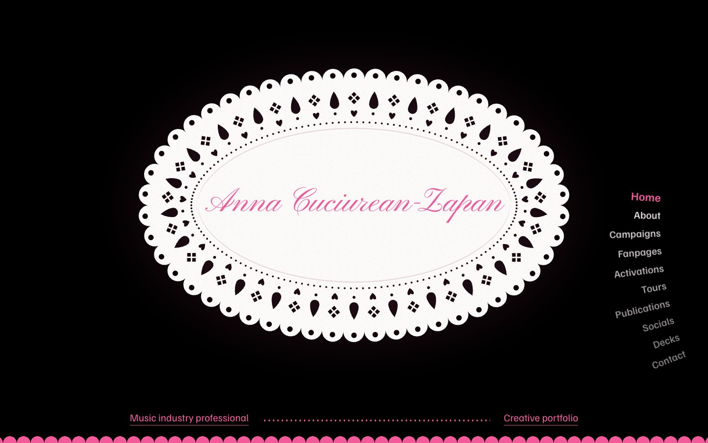
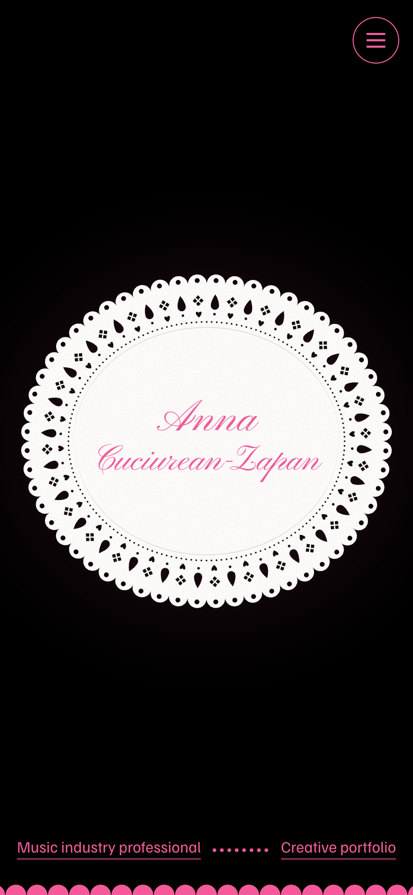
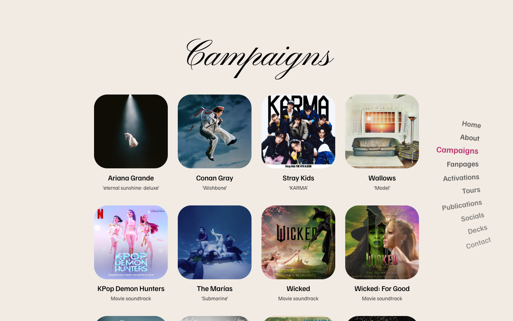
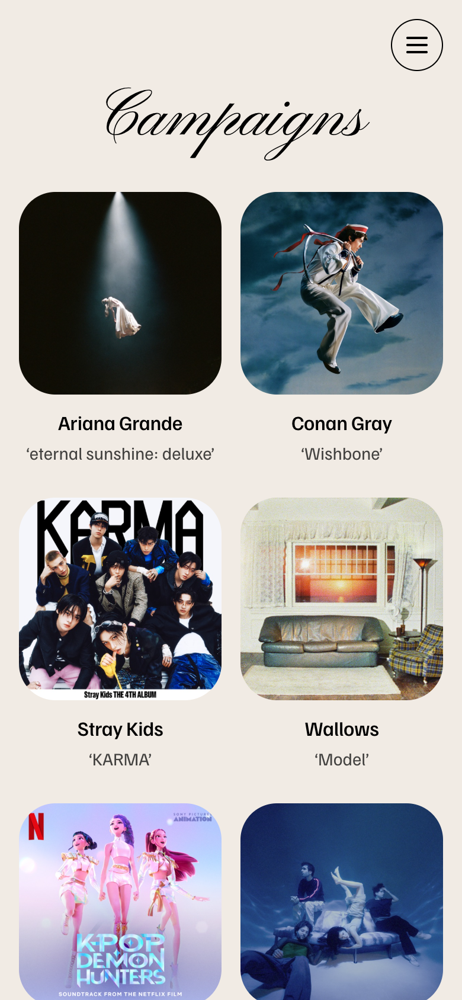

# Anna Cuciurean-Zapan · Portfolio

Portfolio site for Anna Cuciurean-Zapan, a music industry professional working across marketing, social media, PR and journalism. Built with React, TypeScript, and Vite.

The design started from Anna's portfolio in Canva and was adapted for the web with Claude Code: the same black, pink and cream look, rebuilt as a single page with real text, links and layouts that work from phones to wide screens.

## Design

| Desktop | Mobile |
|---|---|
|  |  |
|  |  |

## Design Ideals

- Warm and inviting rather than technical: the Canva palette of black, pink and cream, set in Pinyon Script for headings and Familjen Grotesk for everything else
- Opens on a lace doily with Anna's name, drawn as an SVG, with a one-line tagline pinned to the bottom of the screen
- Sections laid down like sheets of paper: About slides up over the landing page, Campaigns over About, and Contact over Decks, with scalloped edges where they meet
- The portfolio sections run on together in cream, separated by a small dotted rose traced from the Canva design's cross-stitch roses
- Each section has its own layout: album covers, fan pages on drawn phones, flip cards for fan activations, a looping reel of tour posters, article cards styled after each outlet, Instagram-style grids and fanned slide decks
- Details on demand: activation cards flip to reveal the write-up, and links open the full articles and decks
- A side navigation on a gentle arc, after React Bits' [Option Wheel](https://reactbits.dev/components/option-wheel), whose highlight follows the scroll and changes colour with the section behind it; a compact menu on phones
- Contact without exposing the email: it's only assembled when someone clicks Copy email, so it never appears in the page source
- Responsive down to phone widths, and respects `prefers-reduced-motion` throughout

## Stack

- React + TypeScript
- Vite
- HTML & CSS
- Motion, for React Bits' [Flip Card](https://reactbits.dev/micro/flip-card) on the activation cards
- Album artwork from Apple's iTunes Search API, saved with the site
- Fonts from Google Fonts

## Running locally

```bash
npm install
npm run dev
```
